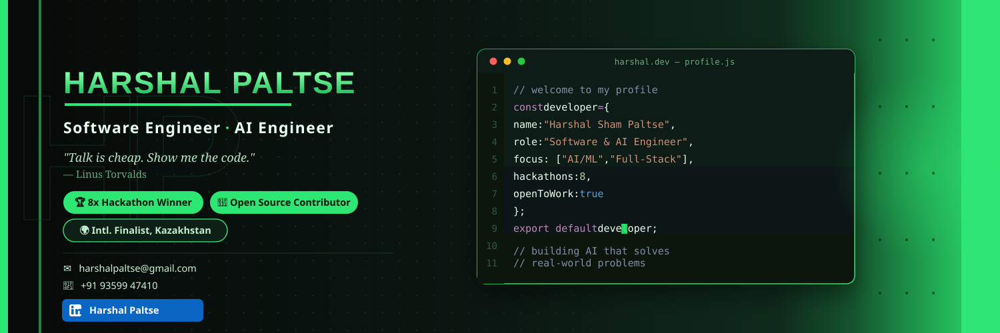

<h2 align="center"> Hackathon Achievements</h2>

| Achievement | Details |
|---|---|
| **Winner in 8 National Hackathons** | Blockverse, SKH Technofest, UpXGen (Solo), SIH Internal Hackathon, Oscillation |
| **Runner-Up** | Avishkar Hackathon, Techathon 2.0 (Pune) |
| **International Finalist** | BioDiversity Hackathon, Kazakhstan |
| **National Finalist** | Finalist in 12 National Hackathons |

<h2 align="center"> Open Source Contributions</h2>

<b>View All 6 Merged Upstream Pull Requests</b>

| # | Repository | PR | Functional Scope | Merge Date | Merge Commit |
|:---:|---|:---:|---|:---:|:---:|
| 1 | `JetBrains/thinkrail` | [#1125](https://github.com/JetBrains/thinkrail/pull/1125) | `fix(cli): reject empty/non-decimal --port and --host, ignore invalid env values` | 2026-11-06 | `519286be` |
| 2 | `JetBrains/thinkrail` | [#1190](https://github.com/JetBrains/thinkrail/pull/1190) | `fix(web): parse THINKRAIL_WEB_PORT and THINKRAIL_PORT strictly in vite config` | 2026-11-05 | `a0fccdc9` |
| 3 | `JetBrains/thinkrail` | [#1156](https://github.com/JetBrains/thinkrail/pull/1156) | `fix(dev): parse THINKRAIL_PORT strictly in the dev launchers` | 2026-11-05 | `8cd11e67` |
| 4 | `SuiteCRM/SuiteCRM` | [#10913](https://github.com/SuiteCRM/SuiteCRM/pull/10913) | `Fixed #10907 - Remove unintended < symbol from SuiteCRM trademark notice` | 2026-10-29 | `ccb02b1` |
| 5 | `mlflow/mlflow` | [#25829](https://github.com/mlflow/mlflow/pull/25829) | `fix: treat .ipynb notebooks as text/plain in artifact preview` | 2026-09-22 | `7e221982` |
| 6 | `K-Tanish/symptom-assist` | [#18](https://github.com/K-Tanish/symptom-assist/pull/18) | `Fix: Improve Groq API error handling with retry logic (Fixes Bug #2)` | 2026-04-20 | `e656cbf` |

🔎 <a href="https://github.com/pulls/search?q=is%3Apr+author%3Aharshal-paltse+sort%3Aupdated-desc">View all my pull requests on GitHub</a>

<h2 align="center"> Tech Stack & Tools</h2>

<table align="center">
<tr>
<th>Languages</th>
<th>Frontend</th>
<th>Backend & Database</th>
<th>AI & LLM</th>
<th>Tools</th>
</tr>
<tr>
<td align="center">

 
 

</td>
<td align="center">

 
 
 
 

</td>
<td align="center">

 
 
 

</td>
<td align="center">

 
 

</td>
<td align="center">

 
 
 
 

</td>
</tr>
</table>

<em>Crafting intelligent systems, shipping reliable code, and solving real-world problems.</em>

  

